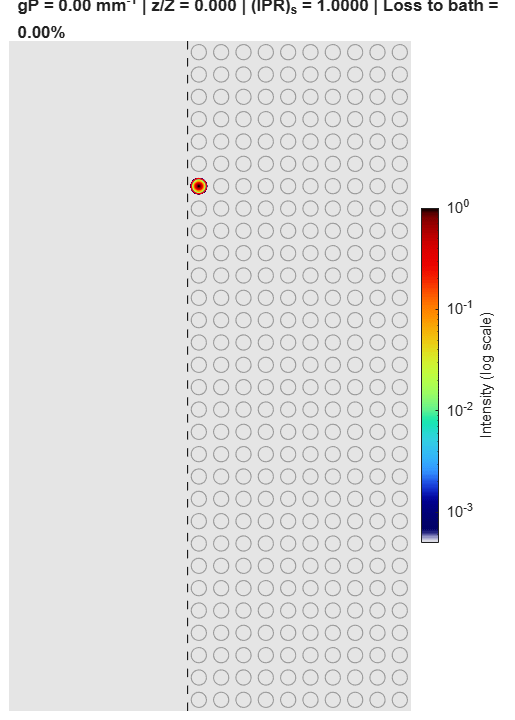
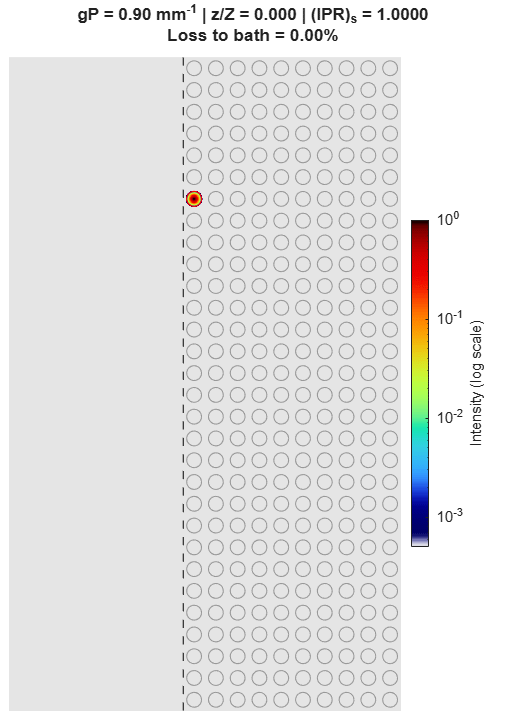
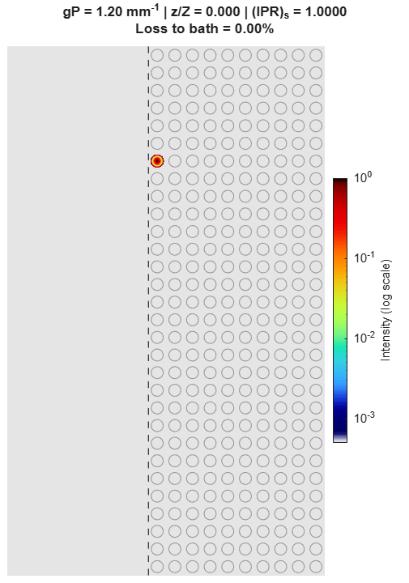

## Nonlinearity-Induced Suppression of Dissipation in Bath-Coupled Floquet Topological Insulators
## supplementary movies

Supplementary Movie 1

Supplementary Movie 2

Supplementary Movie 3 

Supplementary Movie 4 

Supplementary Movie 5

